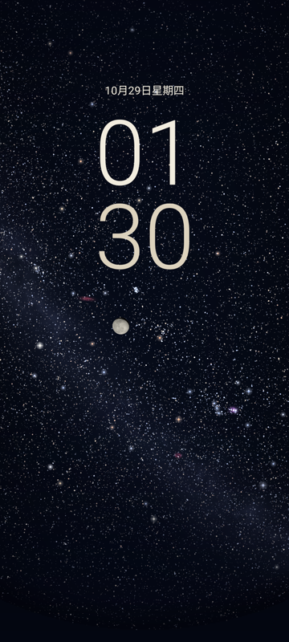

# 星野 / Starfield

Android 17+ 原生星空动态壁纸：在锁屏上显示与日期、地点相对应的星空、月球与时钟。Java + OpenGL ES 3.0，离线运行，无广告、账号、分析上传或互联网权限。

**当前版本：1.2.1 · 最低/目标/编译 API：37 · 自有代码：MIT**



## 功能

- 数字 / 传统指针 / 使用系统时钟；精简模式仅保留自绘时间、日期和星空。
- 与交互预览相同的 HYG v4.1 数据库：115,570 颗真实恒星，3–11 等显示上限；暗星端不宣称完备。
- 120°–180°对角线等距鱼眼视场，八方位、天顶、精确方位角与仰角。
- 星点闪烁、亮星大小、暗星亮度、银河光晕与暗云分别可调。
- 12 处按 OpenNGC 坐标定位的星云，以及随日期与位置变化的月球、月相和月面纹理。
- 手动城市/经纬度/时区，或经用户授权跟随位置；可指定观测时间。
- “载入对话预览参数”可载入香港夜景的同一组参数，方便对比安卓与预览。

## 安装与使用

自行构建 APK，或使用维护者未来在 GitHub Releases 发布的安装包。仓库不保存私钥或历史 APK。

打开星野 → 调整设置 → 应用动态壁纸 → 在系统选择器选择桌面/锁屏目标。系统提供的目标随设备而异。系统时钟无法由普通壁纸隐藏，出现双时钟时请选择“使用系统时钟（仅星空）”。

首次安装默认香港、9 等、暗星亮度 120%、亮星大小 70%、180° FOV、方位角 94°、仰角 79°，跟随真实时间。升级保留原有偏好。“载入对话预览参数”会切到 2026-10-29 01:30 香港时间；开启“跟随真实日期和时间”即可恢复实时。

## 从源码构建

已经附带编译好的星表、月球星历和贴图，普通构建不需要重新下载天文原始数据。

Windows、Python 3.11+：

```powershell
python tools/bootstrap_android.py
python tools/verify_android_catalog.py
python tools/build_android.py
```

输出：`dist/Starfield-1.2.1-android17.apk`。脚本下载并校验官方 JDK/Android 工具，隔离到 `.toolchains/`，不改系统安装。首次构建生成你自己的本地签名，位于 `.signing/`。自己的签名无法覆盖其他维护者签名的安装。

也可用 Android Studio 打开 `android/`，指定 JDK 17+ 和 SDK 37；工程声明 AGP 9.1.1，需要 Gradle 9.3.1。仓库未附 Gradle Wrapper；已验证的命令行流水线是上述 Windows 脚本。完整说明见 [构建、测试与数据重建](docs/BUILDING.md)。

## 查看交互预览

```text
python tools/serve_preview.py
```

在浏览器打开脚本打印的本机地址。预览与安卓直接使用同一份压缩星表；也可以修改 `preview/` 后运行 `python tools/build_preview.py` 再预览。

## 开发与验证

```text
node --test tests/sky-math.test.cjs tests/celestial-math.test.cjs
python tools/verify_android_catalog.py
python tools/verify_open_source.py
```

GitHub Actions 配置了数学测试、数据/发布检查和 Windows 原生构建；远端结果以 Actions 页面为准。更多设备和 GPU 测试见构建文档。欢迎阅读 [贡献指南](CONTRIBUTING.md)、[安全报告说明](SECURITY.md) 和 [更新记录](CHANGELOG.md)。

## 仓库结构

| 路径 | 内容 |
| --- | --- |
| `android/` | 原生 App、GLES 着色器、离线数据及设备测试 |
| `preview/` | Canvas 预览与共享天文数学 |
| `data/` | 预览数据、派生目录和第三方来源说明 |
| `vendor/astronomy/` | MIT 授权的 Astronomy Engine 2.1.19 |
| `tools/` | 构建、数据准备、验证、预览与开源打包 |
| `tests/` | 离线数学与数据测试 |
| `docs/` | 架构、构建与发布文档 |

## 数据、许可与限制

程序代码使用 [MIT](LICENSE)。HYG 和 OpenNGC 派生数据保留 [CC BY-SA 4.0](LICENSES/CC-BY-SA-4.0.txt)，Astronomy Engine 保留 MIT，NASA 月面贴图保留来源与团队鸣谢。各文件范围、来源和修改方式见 [NOTICE](NOTICE.md)；根目录 MIT 不替代第三方许可。

银河与星云色彩/纹理经过艺术增强，星云和月球默认采用艺术放大，均可调回真实角尺寸。白天仍显示星空，未模拟日光、月光照亮天空、折射和光污染；星图用于壁纸效果，不用于精密观测。不同屏幕比例、字体与抗锯齿会影响最终画面。

已完成 Android 17 模拟器上的安装、渲染、覆盖更新和指定场景像素校验；厂商真机、AOD 与长期耗电仍需验证。定位信息仅在设备本地处理，拒绝授权时仍可手动使用。
